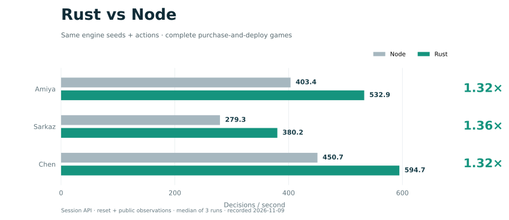

<a name="top"></a>

<p align="center">
  
</p>

<h3 align="center">Stronghold Protocol · Reinforcement Learning Environment</h3>

<p align="center"><a href="README.md">简体中文</a> · <strong>English</strong></p>

<p align="center">Run complete solo games, connect a learning policy, and inspect each decision.</p>

<p align="center">
  <a href="LICENSE"></a>
  <a href="https://www.python.org/"></a>
  <a href="https://www.rust-lang.org/"></a>
  <a href="https://gymnasium.farama.org/"></a>
</p>

<p align="center"><a href="#quick-start">Quick start</a> · <a href="#environment-api">Environment API</a> · <a href="#performance">Performance</a> · <a href="#documentation">Documentation</a> · <a href="#license-and-acknowledgments">License</a></p>

## Overview

A Gymnasium environment for Stronghold Protocol, targeting solo Desperation mode (`mode_single_abyss`). The 0.3.3 Rust runtime handles combat, bookkeeping, rewards, candidates, and numeric encoding, with vector execution and combat replay support. Policy research lives in ArkGuardRL. [Upstream game](https://github.com/sganggs/Stronghold-Protocol) · [Policy research](https://github.com/HarcoChen/ArkGuardRL)

## Quick start

Prepare Python 3.12, Rust stable, system linker tools, and an external 0.3.3 data directory.

```sh
git clone https://github.com/ArkStrongholdRL/ArkGuardRL-Core.git
cd ArkGuardRL-Core
python -m pip install -e '.[gym]'
PYO3_PYTHON="$(command -v python)" cargo build --release --locked -p arkguard-python
```

```python
import gymnasium as gym
import arkguardrl_core.native_gym

with gym.make(
    "ArkGuardRL-v1",
    data_root="/path/to/0.3.3/data",
    core="band_sarkazb",
    native_library="target/release/lib_native.dylib",
) as env:
    env.action_space.seed(42)
    obs, info = env.reset(seed=42)
    while True:
        action = env.action_space.sample(mask=obs["action_mask"])
        obs, reward, terminated, truncated, info = env.step(action)
        if terminated or truncated:
            break
```

Replace random sampling with your policy's candidate row. Supported cores are `band_amiya`, `band_sarkazb`, `band_chen`, and `band_sciurus`.
On Linux use `lib_native.so`. On Windows use the `_native*.pyd` CI artifact. [Cross-platform builds](docs/benchmarks/README.md#跨平台构建)

## Environment API

Observations are NumPy dictionaries. Actions reference current candidate rows, with a default capacity of 16,384.

| Field | Shape and type |
| --- | --- |
| `observation` | `(4784,) float32` |
| `candidates` | `(max_candidates, 41) float32` |
| `schedules` / `experts` | `(max_candidates,) int64` |
| `action_mask` | `(max_candidates,) int8` |

- Inspect `info["accepted"]` and `info["reward_components"]` for action and reward results. Padding, invalid indices, and candidate overflow raise errors.
- Natural endings return `terminated`. Exhausted budgets return `truncated` and `info["reason"]`. Seeds reproduce runs, and `reset(seed=None)` continues the RNG stream.
- Gym supports Sync / Async. Rust slots support 1–64 environments and partial resets. Async `spawn` requires an `if __name__ == "__main__"` entry point.

## Performance



Rust / Node session APIs, recorded November 9, 2026. Complete purchase-and-deploy games with the same engine seeds and actions, median of three runs, including reset and public observations. [Timing scope and benchmark entrypoints](docs/benchmarks/README.md#测速与回归)

## Documentation

[Builds, spatial APIs, replays, and benchmarks](docs/benchmarks/README.md) · [Issue tracker](https://github.com/ArkStrongholdRL/ArkGuardRL-Core/issues)

```text
src/          Python packages
crates/       Rust engine and extensions
docs/         Usage guide and figures
benchmarks/   Benchmark tools and measurements
.github/      CI
```

## License and acknowledgments

GPL-3.0-or-later. Stronghold Protocol provides the upstream simulator. See the licensing notes for game assets and external data. [LICENSE](LICENSE) · [NOTICE](NOTICE.md)

<p align="center"><a href="#top">Back to top</a></p>
