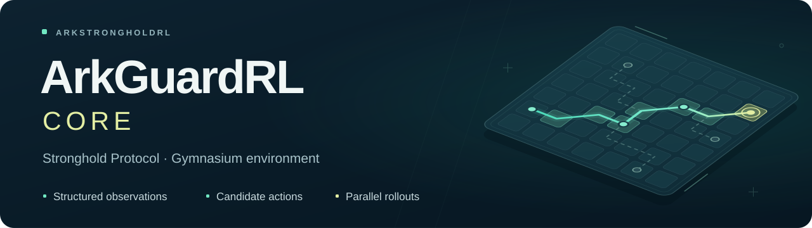

<a name="top"></a>

<p align="center">
  
</p>

<h3 align="center">Stronghold Protocol · Reinforcement Learning Environment</h3>

<p align="center"><a href="README.md">简体中文</a> · <strong>English</strong></p>

<p align="center">Run complete solo games, connect a learning policy, and inspect each decision.</p>

<p align="center">
  <a href="LICENSE"></a>
  <a href="https://www.python.org/"></a>
  <a href="https://www.rust-lang.org/"></a>
  <a href="https://gymnasium.farama.org/"></a>
</p>

<p align="center"><a href="#quick-start">Quick start</a> · <a href="#environment-api">Environment API</a> · <a href="#performance">Performance</a> · <a href="#documentation">Documentation</a> · <a href="#license-and-acknowledgments">License</a></p>

## Overview

ArkGuardRL-Core exposes the purchasing, team-building, and deployment decisions of Stronghold Protocol through Gymnasium.
Public observations, candidate actions, rewards, and episode boundaries let a policy drive complete games through `reset` and `step`.
Game rules follow the Stronghold Protocol simulator. [Upstream project](https://github.com/sganggs/Stronghold-Protocol)

| Core runtime | Policy research |
| --- | --- |
| Game execution, public observations, candidate enumeration, and numeric encoding | Model representations, policy networks, and learning algorithms |
| Seeded reproduction, decision budgets, and vector collection | Trajectory collection, training, and policy evaluation |
| Maintained in this repository | Maintained in [ArkGuardRL](https://github.com/HarcoChen/ArkGuardRL) |

Maintenance targets solo Desperation mode (`mode_single_abyss`), using the **0.3.3 native Rust runtime**.
Rust executes combat, public bookkeeping, rewards, candidate generation, and numeric encoding. Python provides Gymnasium and collection interfaces.

## Quick start

Use Python 3.12, Git, Rust stable, and system linker tools. Prepare the Stronghold Protocol 0.3.3 data directory separately.

```sh
git clone https://github.com/ArkStrongholdRL/ArkGuardRL-Core.git
cd ArkGuardRL-Core
python -m pip install -e '.[gym]'
PYO3_PYTHON="$(command -v python)" cargo build --release --locked -p arkguard-python
```

CI provides Python 3.12 modules for Linux x64, Windows x64, and macOS Intel / Apple Silicon.
The example uses a macOS library path. On Linux, use `target/release/lib_native.so`. On Windows, use the actual path of the `_native*.pyd` CI artifact. [Cross-platform builds](docs/benchmarks/README.md#跨平台构建)

### Run a game

```python
import gymnasium as gym
import arkguardrl_core.native_gym

with gym.make(
    "ArkGuardRL-v1",
    data_root="/path/to/0.3.3/data",
    core="band_sarkazb",
    native_library="target/release/lib_native.dylib",
) as env:
    env.action_space.seed(42)
    obs, info = env.reset(seed=42)
    while True:
        action = env.action_space.sample(mask=obs["action_mask"])
        obs, reward, terminated, truncated, info = env.step(action)
        if terminated or truncated:
            break
```

The example samples candidates using the mask. Replace `action` with the candidate row selected by your policy.

## Environment API

| Interface | Use |
| --- | --- |
| `ArkGuardRL-v1` | A native single-environment Gymnasium decision loop |
| `SyncVectorEnv` / `AsyncVectorEnv` | Vector collection with an independent session per environment |
| Rust slots | 1–64 environments, partial resets, and selective stepping |
| `env.unwrapped.public_spatial()` | Read public maps, current template routes, and enemy preview associations |
| `env.unwrapped.catalog.definitions()` | Read public static definitions |
| `info` | Inspect action acceptance, reward components, engine seeds, and episode reasons |

Supported cores are Amiya (`band_amiya`), Sarkaz (`band_sarkazb`), Chen (`band_chen`), and Sciurus (`band_sciurus`).
Observations are dictionaries of NumPy arrays. Action indices refer to the current state's candidate rows. The default capacity is 16,384.

| Field | Shape and type |
| --- | --- |
| `observation` | `(4784,) float32` |
| `candidates` | `(max_candidates, 41) float32` |
| `schedules` / `experts` | `(max_candidates,) int64` |
| `action_mask` | `(max_candidates,) int8` |

<details>
<summary>Actions, seeds, and rollout semantics</summary>

- Candidates are constructed from public information. Check `info["accepted"]` for execution results. Padding or out-of-range indices raise `InvalidAction`. Candidate overflow raises an error.
- The same Gym seed reproduces the environment. `info["engine_seed"]` exposes the derived seed. `reset(seed=None)` continues the RNG stream. Action sampling uses a separate RNG.
- `NativeProgressCore` computes rewards. Components appear in `info["reward_components"]`.
- Natural endings return `terminated`. Exhausting `max_decisions`, `max_advances`, or `wall_seconds` returns `truncated`, the actual successor observation, and `info["reason"]`. Engine or transport failures raise exceptions.
- Set difficulty and budgets at construction. Single-environment `reset(options=...)` accepts an empty configuration.
- Async collection with `spawn` requires an `if __name__ == "__main__"` entry point. Each environment owns an independent native session.

</details>

Use `env.unwrapped.public_spatial_update(key)` for incremental spatial reads. The benchmark guide also covers human-record regression and renderable combat trajectories. [Spatial APIs and replay export](docs/benchmarks/README.md)

<details>
<summary>Node v0 compatibility</summary>

Existing callers can register `ArkGuardRL-v0` through `import arkguardrl_core.gym_env` and pass `engine_root` at construction.
This entry point uses Node.js 22+ and the 0.3.1 engine / data.

</details>

## Performance

| Configuration and timing scope | Decisions per second |
| --- | ---: |
| Native Gym, 1 environment, purchase-and-deploy policy | 437.2 |
| Rust slots, 4 environments / 4 threads, including spatial JSON reads | 585.7 |

These full-game A/B measurements include native candidate preparation and indexed execution, covering environment and interface overhead.
Model inference and training are timed separately. See the benchmark guide for workload definitions, human-record regression, historical measurements, and reproduction commands. [Performance benchmarks](docs/benchmarks/README.md)

## Repository layout

```text
src/          Python environment packages
crates/       Rust engine, Python bindings, and parallel extension
docs/         API guides, migration notes, and performance documentation
benchmarks/   Benchmark scripts and measurement data
.github/      Cross-platform CI
```

## Documentation

Detailed development notes are currently in Chinese.

| Guide | Contents |
| --- | --- |
| [Performance benchmarks](docs/benchmarks/README.md) | Measurements, timing scope, and commands |
| [Rust feature kernels](docs/RUST-ROUTES.md) | Action and observation encoding responsibilities and ABI |
| [Native migration notes](docs/NATIVE-033.md) | Implementation scope and migration history of the 0.3.3 native runtime |
| [Issue tracker](https://github.com/ArkStrongholdRL/ArkGuardRL-Core/issues) | Interface issues and reproducible reports |

## License and acknowledgments

Code is licensed under GPL-3.0-or-later. Stronghold Protocol provides the upstream simulator. See the license and attribution notes for game assets and external data. [LICENSE](LICENSE) · [NOTICE](NOTICE.md)

The landing-page layout draws on AutoTavern. The banner is an original schematic illustration. [AutoTavern](https://github.com/MCG-NJU/AutoTavern)

<p align="center"><a href="#top">Back to top</a></p>
