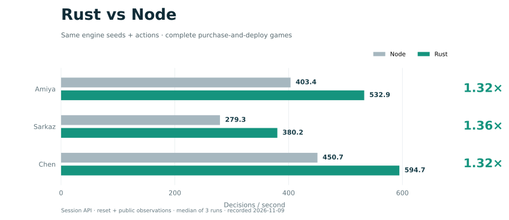

<a name="top"></a>

<p align="center">
  
</p>

<h3 align="center">卫戍协议 · 强化学习环境</h3>

<p align="center"><strong>简体中文</strong> · <a href="README.en.md">English</a></p>

<p align="center">复现完整单人对局，接入学习策略，检查每一步的决策结果。</p>

<p align="center">
  <a href="LICENSE"></a>
  <a href="https://www.python.org/"></a>
  <a href="https://www.rust-lang.org/"></a>
  <a href="https://gymnasium.farama.org/"></a>
</p>

<p align="center"><a href="#快速开始">快速开始</a> · <a href="#环境接口">环境接口</a> · <a href="#性能">性能</a> · <a href="#文档">文档</a> · <a href="#许可与致谢">许可与致谢</a></p>

## 概览

《卫戍协议：盟约》的 Gymnasium 环境，维护单人绝境模式（`mode_single_abyss`）。0.3.3 Rust 运行时负责战斗、账本、奖励、候选和数值编码，支持多环境并行与战斗回放。策略研究在 ArkGuardRL 维护。[上游游戏](https://github.com/sganggs/Stronghold-Protocol) · [策略研究](https://github.com/HarcoChen/ArkGuardRL)

## 快速开始

准备 Python 3.12、Rust stable、系统链接工具及外部 0.3.3 数据目录。

```sh
git clone https://github.com/ArkStrongholdRL/ArkGuardRL-Core.git
cd ArkGuardRL-Core
python -m pip install -e '.[gym]'
PYO3_PYTHON="$(command -v python)" cargo build --release --locked -p arkguard-python
```

```python
import gymnasium as gym
import arkguardrl_core.native_gym

with gym.make(
    "ArkGuardRL-v1",
    data_root="/path/to/0.3.3/data",
    core="band_sarkazb",
    native_library="target/release/lib_native.dylib",
) as env:
    env.action_space.seed(42)
    obs, info = env.reset(seed=42)
    while True:
        action = env.action_space.sample(mask=obs["action_mask"])
        obs, reward, terminated, truncated, info = env.step(action)
        if terminated or truncated:
            break
```

将随机采样替换为策略选出的候选行索引即可接入模型。核心支持 `band_amiya`、`band_sarkazb`、`band_chen`、`band_sciurus`。
Linux 动态库为 `lib_native.so`，Windows 使用 CI 的 `_native*.pyd`。[跨平台构建](docs/benchmarks/README.md#跨平台构建)

## 环境接口

观测为 NumPy 字典，动作引用当前候选行，默认容量 16,384。

| 字段 | 形状与类型 |
| --- | --- |
| `observation` | `(4784,) float32` |
| `candidates` | `(max_candidates, 41) float32` |
| `schedules`／`experts` | `(max_candidates,) int64` |
| `action_mask` | `(max_candidates,) int8` |

- 动作结果见 `info["accepted"]`，奖励分项见 `info["reward_components"]`。padding、越界和候选超限会报错。
- 自然结束为 `terminated`，预算耗尽为 `truncated`，原因见 `info["reason"]`。相同种子可复现，`reset(seed=None)` 延续 RNG 流。
- Gym 支持 Sync／Async，Rust slots 支持 1–64 个环境及局部重置。Async `spawn` 入口使用 `if __name__ == "__main__"`。

### 逐决策公开反馈

NativeSolo 和 NativeBatch 的 decision ledger JSON 现在包含独立的 `feedback` 字段。
`NativeLedgerEnv.feedback` 和 Rust slots 的 `info["feedback"]` 返回该侧带记录。
重置时为 `null`，每次决策替换为 `arkguard.decision-feedback.v1`，包含
`decisionRevision`、`resultRevision` 和按 transport revision 排列的 `receipts`。
每个 receipt 使用 `arkguard.public-feedback.v1`，携带 `revision`、`battle`、`economy`。
反馈由动作及后续自动战斗共同生成，初始设置授予发生在首个决策之前。

`battle` 在战斗结算时包含 1 起算 `round`、`units`、`complete`、`partial`、
`droppedUnits`、`missingMetrics`。每行有局内 `battleUnitId`、准备阶段 `sourceUid`、
召唤者 `ownerSourceUid`、`ownerAttributionComplete`、`kind`，以及真实累计的
`damage`、`healing`、`taken`、`attacks`、`kills`。
`damage` 是异阵营归属伤害，`taken` 是实际 HP 损失，`healing` 是有效治疗量，
`attacks` 使用现有攻击事件计数，`kills` 使用 `deployment.kills` 的直接击杀归属。
直接击杀计数与出怪 ledger 的 `creditedKills` 有各自口径，召唤物单列，调用方可按
`ownerSourceUid` 汇总。准备棋子 UID 缺失或召唤者已释放时对应值为 `null`，
归属缺失独立标记。永久移除盟友的最终统计保留，最多 4096 行，超出后
`droppedUnits > 0`、`partial=true`。完整性描述计数保留情况，技能实现覆盖另行判断。
当前接口未提供阻挡次数和阻挡时长。

`economy.events` 包含 1 起算 `round` 和 `sourceBond`、`effect`。
`miraShip`／`visiShip` 的层数返金报告实际 `amount` 和入账 `destination`
（`funds` 或 `pendingFunds`），`miraShip` 免费刷新报告已授予次数。
`investShip` 报告额外驻守调用的 `sourceUid`、`garrisonId`、1 起算 `invocation`，
以及实际 `fundsDelta`、`pendingFundsDelta`、`freeRefreshesDelta`。
该增量包含调用内嵌套效果，返金事件可能同时描述其中的入账，消费方须避免重复累计。
物品和层数等非货币结果尚缺归属，故 invest 事件 `complete=false`。
经济总对象始终标 `complete=false`、`partial=true`，用 `coverage`／`missing` 列明范围。
单次累积最多保留 4096 个经济事件，截断数见 `droppedEvents`。

## 性能



Rust／Node 会话接口对照，2026-11-09，同种子、同动作的完整购买部署对局，三轮中位数，计入 reset 与公开观测。[测量范围与复现入口](docs/benchmarks/README.md#测速与回归)

## 文档

[构建、空间接口、回放与基准](docs/benchmarks/README.md) · [问题反馈](https://github.com/ArkStrongholdRL/ArkGuardRL-Core/issues)

```text
src/          Python 包
crates/       Rust 引擎与扩展
docs/         使用说明与图表
benchmarks/   基准工具与测量数据
.github/      CI
```

## 许可与致谢

GPL-3.0-or-later。Stronghold Protocol 提供上游模拟实现，游戏素材与外部数据的来源和使用边界见许可说明。[LICENSE](LICENSE) · [NOTICE](NOTICE.md)

<p align="center"><a href="#top">回到顶部</a></p>
