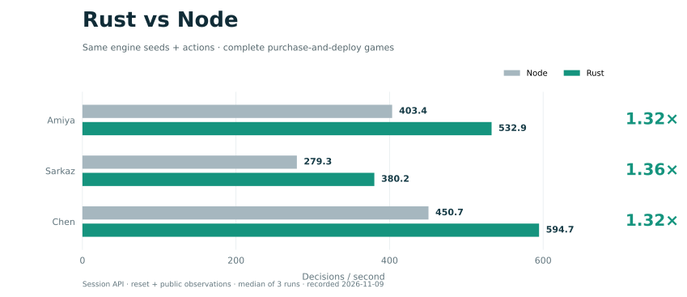

# 性能基准

[项目主页](../README.md) · [最新结果](#最新结果) · [测量边界](#测量边界) · [运行基准](#运行基准) · [历史对照](#历史对照)

测量 Gymnasium 环境的端到端决策吞吐，为运行时优化提供可复查的基线。
脚本均匀抽样当前有效候选，不加载学习策略或训练器。

## 最新结果

**2026-11-02 · Apple M5 / 16 GiB · 0.3.1 引擎（Node.js）+ Rust 动作／观测内核。**
Python 3.12.13、Node.js 26.7.0、Gymnasium 1.4.0、NumPy 2.5.4。
本次测量对应当前可运行的混合运行时，不代表纯 Rust 0.3.3 环境。



| 配置 | 优化前中位数（决策/秒） | 优化后中位数（决策/秒） | 本次变化 |
| --- | ---: | ---: | ---: |
| Sync，1 env | 480.57 | 494.75 | +2.95% |
| Async，共享内存，4 env | 899.14 | 937.19 | +4.23% |

每个环境预热 64 步、测量 1024 步；每批重复 3 次，按旧／新／新／旧顺序运行，各版本合计 6 次。
Gym seed 为 42、采样 seed 为 123，候选容量为 16384。重复从相同种子重新开始，图中散点反映计时波动。
**桌面负载有波动，这些小幅变化不能证明稳定的训练提速。**

[原始数值与校验记录](env-hotspots-20261102.json) · [优化内容与测量说明](HOTSPOTS-20261102.md)

## 测量边界

- **单位是决策/秒。** 吞吐为全部环境的真实决策数除以墙钟时间；不是战斗帧率或完整对局数。
- **计入循环内 reset。** 观测填充、奖励计算、动作抽样和 Gym 通信也在计时范围内；初始 reset、启动和预热单独记录，不进入吞吐分母。
- **每个环境有独立采样 RNG。** 不截断候选域；超出容量时报告错误。自然结束与预算截断分别计数，reset 不算一步。
- **分项时间是所有环境的累计值。** 并行环境的分项耗时不能当作墙钟时间占比，也不能把这些结果等同于模型训练或策略采集吞吐。
- **短时桌面测量有适用范围。** 记录未列操作系统版本、CPU 核心配置及前后代码提交；本页保留原始测量口径，不将它扩展为跨硬件或跨版本结论。

## 运行基准

在仓库根目录执行；将 `ARKGUARD_ENGINE_ROOT` 改为固定版本、干净的 0.3.1 引擎 Git 仓库根目录。
安装及引擎准备见[项目主页](../README.md)。

```sh
python -m pip install -e '.[gym]'
export ARKGUARD_ENGINE_ROOT=/absolute/path/to/engine

python benchmarks/gym_env.py --engine-root "$ARKGUARD_ENGINE_ROOT" \
  --vector sync --envs 1 --warmup 64 --steps 1024 --repeats 3 \
  --seed 42 --rng-seed 123 --max-candidates 16384 --max-decisions 1024 \
  --out artifacts/gym-sync-1.json

python benchmarks/gym_env.py --engine-root "$ARKGUARD_ENGINE_ROOT" \
  --vector async --envs 4 --warmup 64 --steps 1024 --repeats 3 \
  --seed 42 --rng-seed 123 --max-candidates 16384 --max-decisions 1024 \
  --out artifacts/gym-async-4.json
```

每条命令测量当前检出版本，产生 3 次重复。前后对照需在相应版本分别执行，并保留运行顺序；
上表每个版本运行了两批。完整参数与输出字段见 [`gym_env.py`](gym_env.py)。

图表仅从已提交的 JSON 生成，需要 Matplotlib，不会启动环境：

```sh
python benchmarks/plot_throughput.py
```

## 历史对照

**2026-10-28：同一轮测量中的向量化比较。** Apple M5 / 16 GB、Gymnasium 1.4.0，
独立无 Torch 环境；每个环境 1024 步、预热 16 步、重复 3 次，Gym seed 42、采样 seed 123，
候选容量 16384。该轮预热与重复次数不同，且没有可直接对照的代码提交记录，**不能跨两轮计算提速或退化倍率**。

| 配置 | 中位吞吐（决策/秒） | 每次测量墙钟中位数 |
| --- | ---: | ---: |
| Sync，1 env | 447 | 2.29 秒 / 1024 步 |
| Sync，4 env | 451 | 9.08 秒 / 4096 步 |
| Async，共享内存，4 env | 982 | 4.17 秒 / 4096 步 |

同一负载的 4 env 对照中，Async 吞吐为 Sync 的 **2.18 倍**。
动作、奖励与结束标志摘要一致，每次均自然结束 18 局、截断 0 局。
剩余轨迹不一定结束，因此不能用总耗时除以结束局数估算单局耗时。

单环境约 2.24 毫秒/步，包含观测、奖励及 Gym 开销。默认填充观测为每环境 2,984,640 字节，
这是数组大小，不是进程内存占用；该轮最多出现 401 个候选，不代表所有对局的候选上限。
